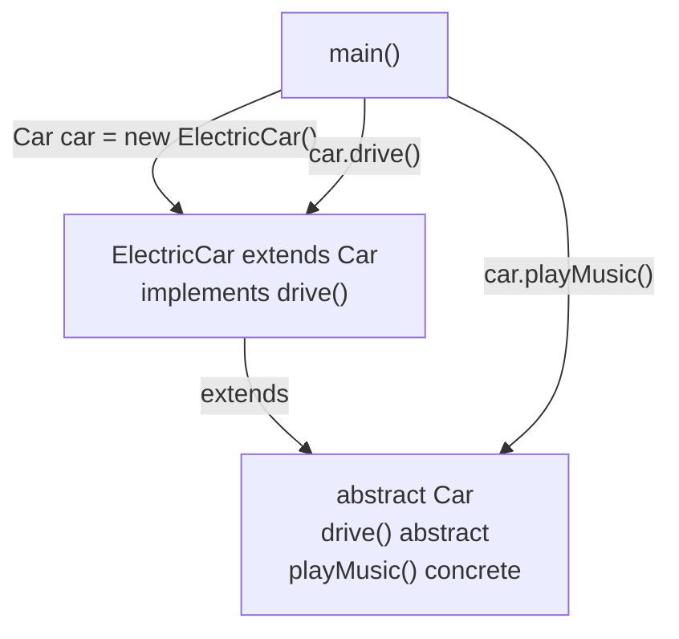
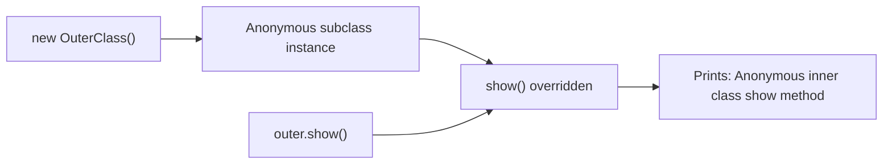

# Java abstract and anonymous class diagrams Implementation Plan

> **For agentic workers:** REQUIRED SUB-SKILL: Use superpowers:subagent-driven-development (recommended) or superpowers:executing-plans to implement this plan task-by-task. Steps use checkbox (`- [ ]`) syntax for tracking.

**Goal:** Add concise Mermaid documentation beside the abstract-class and anonymous-inner-class Java examples.

**Architecture:** Add one Markdown file beside each existing `Demo.java`, following the heading, short explanatory text, and Mermaid fenced-diagram convention in `src/java_2`. Keep Java source unchanged.

**Tech Stack:** Markdown, Mermaid flowcharts.

---

### Task 1: Document the abstract class example

**Files:**
- Create: `src/java_3_advance/AbstractKeyword/AbstractKeyword.md`
- Read: `src/java_3_advance/AbstractKeyword/Demo.java`

- [x] **Step 1: Add the explanation and class/call diagram**

Create `AbstractKeyword.md` with:

````markdown
# AbstractKeyword — abstract class and implementation

`Car` is abstract, so `main` cannot instantiate it directly. `ElectricCar`
implements the abstract `drive()` method. `main` stores an `ElectricCar` in a
`Car` reference, then calls the implementation and the inherited `playMusic()`.


````

- [x] **Step 2: Check the note against `Demo.java`**

Verify that `Car` is abstract, `ElectricCar` overrides `drive()`, and the
diagram describes both calls made through the `Car`-typed reference.

### Task 2: Document the anonymous inner class example

**Files:**
- Create: `src/java_3_advance/AnonymousInnerClass/AnonymousInnerClass.md`
- Read: `src/java_3_advance/AnonymousInnerClass/Demo.java`

- [x] **Step 1: Add the explanation and object/method-flow diagram**

Create `AnonymousInnerClass.md` with:

````markdown
# AnonymousInnerClass — overriding with an anonymous class

`new OuterClass() { ... }` creates an anonymous subclass of `OuterClass` and
overrides `show()`. The `outer` reference points to that instance, so
`outer.show()` runs the anonymous override.


````

- [x] **Step 2: Check the note against `Demo.java`**

Verify the diagram matches the anonymous subclass construction, override, call,
and printed message in the source.

### Task 3: Validate the documentation changes

**Files:**
- Check: `src/java_3_advance/AbstractKeyword/AbstractKeyword.md`
- Check: `src/java_3_advance/AnonymousInnerClass/AnonymousInnerClass.md`

- [x] **Step 1: Check Markdown whitespace and review the diff**

Run:

```powershell
$files = @(
  'src/java_3_advance/AbstractKeyword/AbstractKeyword.md',
  'src/java_3_advance/AnonymousInnerClass/AnonymousInnerClass.md'
)
foreach ($file in $files) {
  $line = 0
  Get-Content $file | ForEach-Object {
    $line++
    if ($_ -match '[ \t]+$') {
      throw "Trailing whitespace at $($file):$line"
    }
  }
}
```

Then open both new files and compare each Mermaid diagram with its Java source.
Expected: no trailing whitespace, and each diagram accurately reflects its
source. No Java test is required because the changes are documentation-only.
