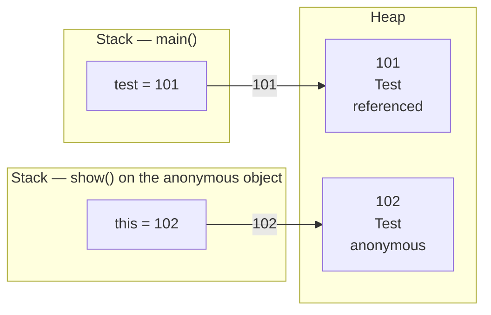

# AnonymousObject — referenced and anonymous

`test` stores **101**, so that `Test` stays reachable after `show()` returns. `new Test().show()` also creates an object, **102**, but `main` never stores that reference. It exists only as `this` inside that one `show()` call. When `show()` returns, nothing points at **102**.

