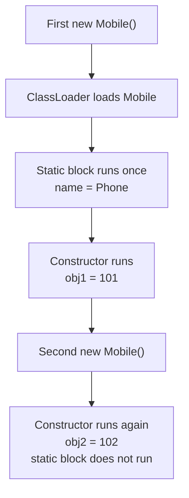
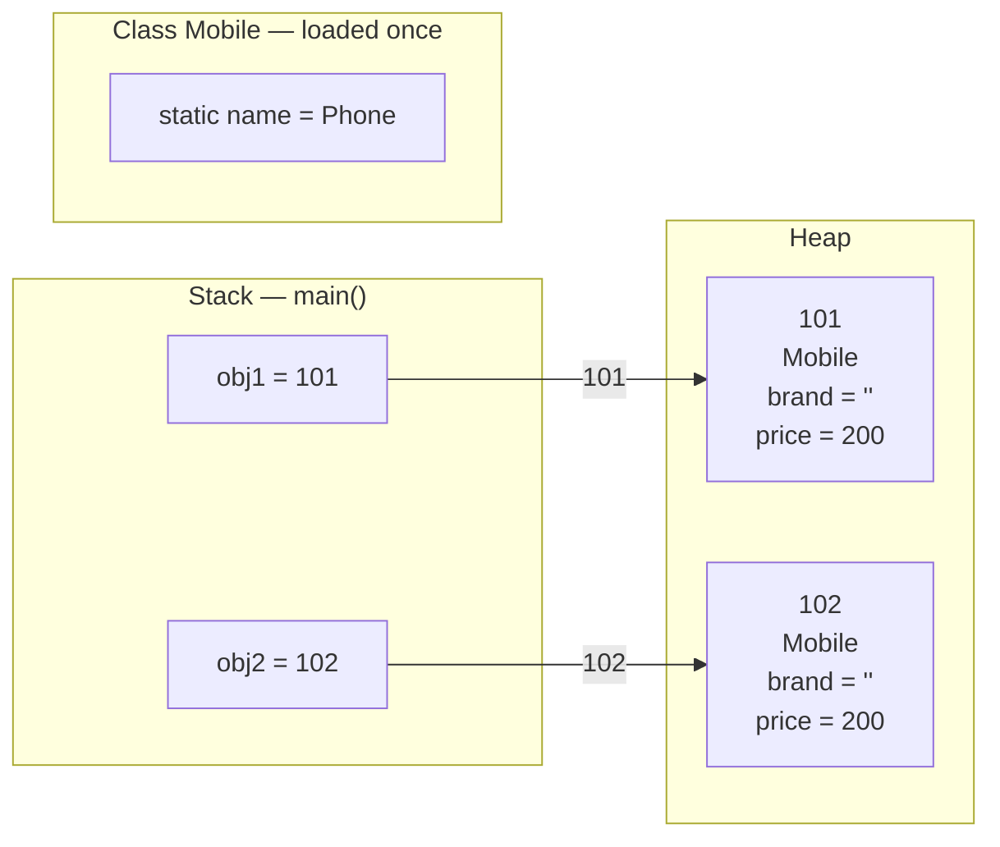

# ConstructorAndStatic — ClassLoader, static, constructor

The first `new Mobile()` makes the ClassLoader load `Mobile`. The static block runs then, once for the class, and sets `name`. The constructor runs only after that, once for each object. The second `new` does not load the class again and does not run the static block.

After both objects exist, the stack holds the two references. `brand` and `price` are on each heap object. `name` stays on the loaded class.

