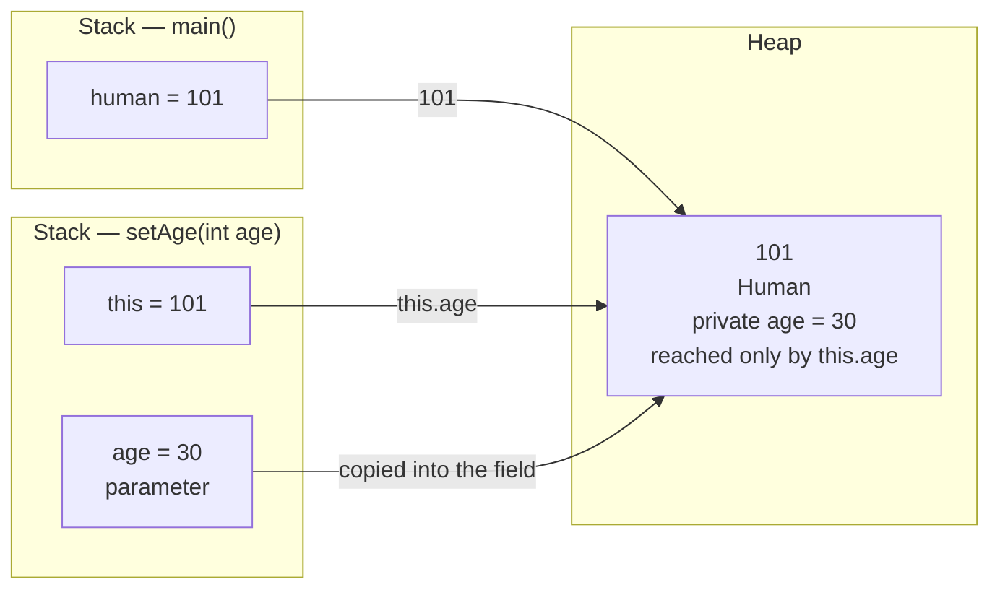

# EncapsulationAndPrivateAndGetterSetter — encapsulation and `this`

`age` and `name` are `private`, so `main` cannot read or write those fields. That hiding is the encapsulation: the data stays inside `Human`, and the public getters and setters are the only way in. `human.setAge(30)` is allowed. `human.age = 30` is not.

`human` stores **101**, the `Human` on the heap. When `setAge(30)` runs, that call gets its own stack frame. `age` there is the parameter, **30**. `this` is the same reference, **101**, so `this.age` is the private field on that object. `this.age = age` copies the parameter into the field. `age = age` would only assign the parameter to itself, and the field would stay **0**. `setName` works the same way: `name` is the parameter, `this.name` is the private field.

