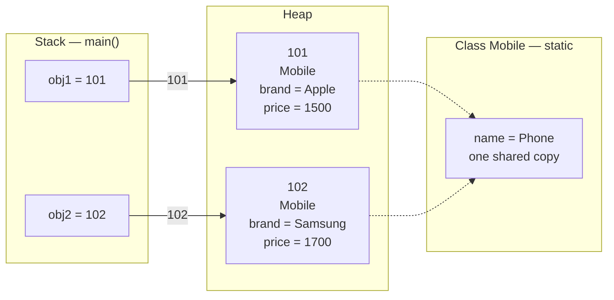

# StaticVar — stack, heap, and the static field

`obj1` and `obj2` are references on the stack. Each stores a number that points at one `Mobile` object on the heap. `name` is `static`, so there is one copy on the class, shared by both objects.

