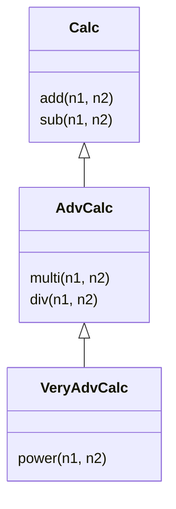

# Inheritance — superclass and subclasses

`Calc` is the superclass. `AdvCalc` extends `Calc`, so it is the subclass and it keeps `add` and `sub`. `VeryAdvCalc` extends `AdvCalc`, so it keeps `add`, `sub`, `multi`, and `div`, and adds `power`.

