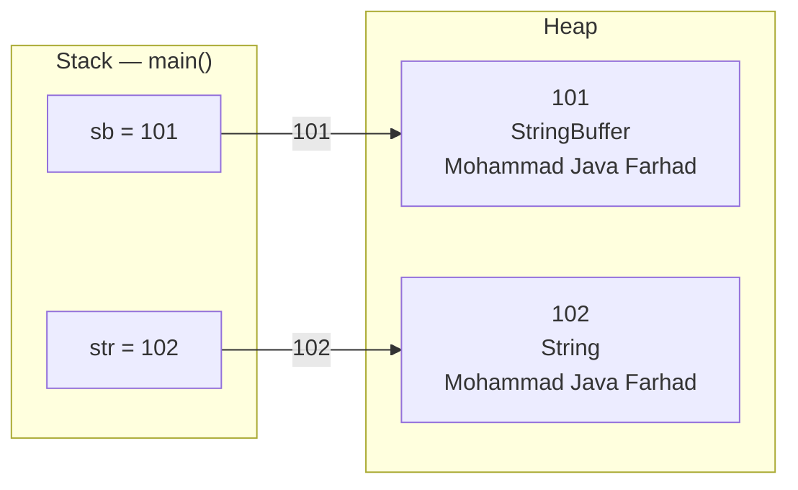

# StringBufferClass — stack and heap

`sb` keeps the same reference, **101**, while `append`, `deleteCharAt`, `insert`, and `setLength` change that one object. `toString()` copies the characters into a new `String`, so `str` stores **102**.

