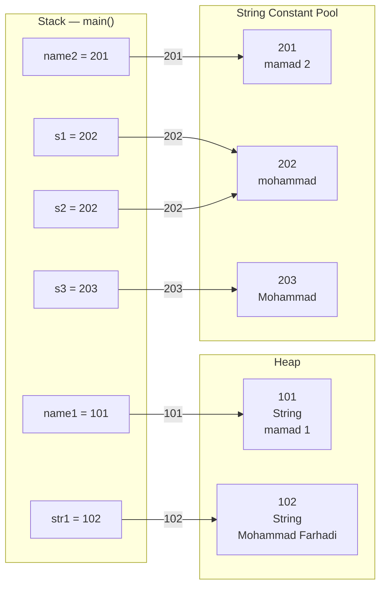

# StringDataType — stack, heap, and the string pool

Each variable on the stack stores a reference number. `new String(...)` and `+` put a new `String` on the heap. A literal lives in the String Constant Pool, a special area of the heap, and the same literal is one object. `s1` and `s2` both store **202**, so they point at the same pooled `"mohammad"`.

