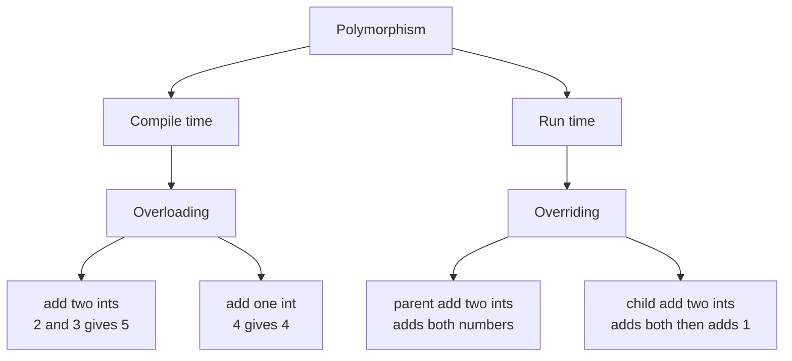

# Polymorphism

Polymorphism means many behaviours. One name can act in more than one way.

Overloading is compile time. The same class has `add(int, int)` and `add(int)`. The compiler picks from the number of inputs. `add(2, 3)` uses the first and gives 5. `add(4)` uses the second and gives 4.

Overriding is run time. The parent has `add(int, int)`. The child has `add(int, int)` too, with the same inputs. The real object picks the behaviour. A parent object adds the two numbers. A child object adds them and then adds 1.

