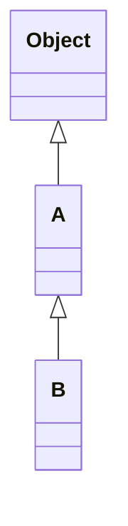
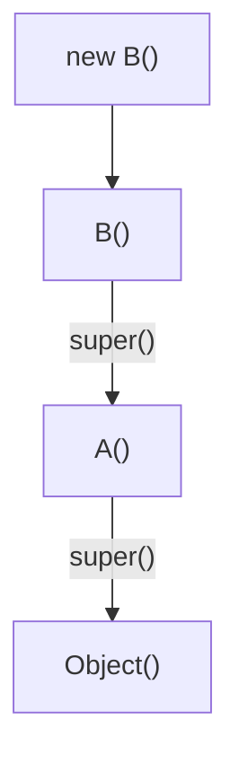
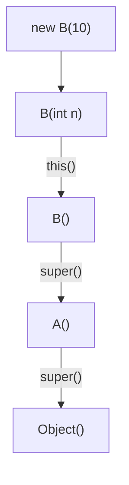

# SuperAndThis — `this()`, `super()`, and the class chain

`A` extends `Object`, and `B` extends `A`. `super()` calls a constructor of the superclass. `this()` calls another constructor of the same class. A constructor uses one of them, and it has to be the first line. The chain always ends at `Object()`.

`new B()` goes through `B()`, then `super()` into `A()`, then `super()` into `Object()`.

`new B(10)` starts at `B(int n)`. That constructor calls `this()`, so it goes to `B()` and only then to `A()` and `Object()`. `super(n)` is commented out, so `A(int n)` is not called. `10` stays in `B` and is printed there.

