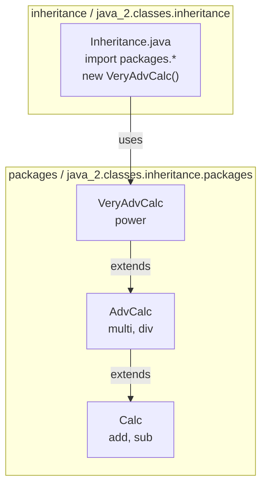

# Inheritance — folders, packages, and subclasses

`Inheritance.java` stays in `inheritance` and belongs to `java_2.classes.inheritance`. `Calc`, `AdvCalc`, and `VeryAdvCalc` are in the `packages` folder, so their package is `java_2.classes.inheritance.packages`. `import java_2.classes.inheritance.packages.*` brings in the classes in that package only, not classes in a deeper folder.

`Calc` is the superclass. `AdvCalc` extends it and keeps `add` and `sub`. `VeryAdvCalc` extends `AdvCalc` and keeps `add`, `sub`, `multi`, and `div`. `main` creates a `VeryAdvCalc`, so it can call all five methods.

