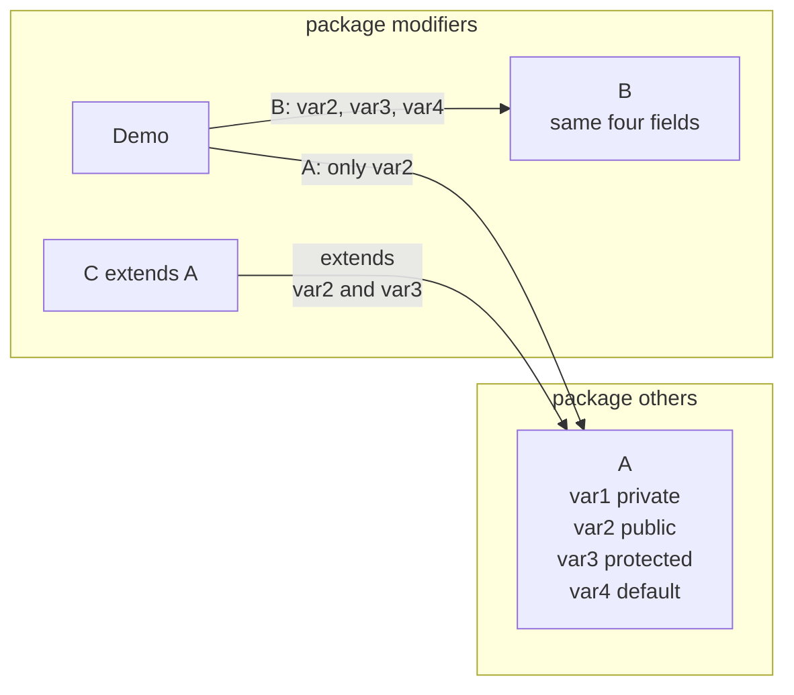

# Modifiers — who can see the fields

`A` is in `others` (`java_2.classes.modifiers.others`). `B`, `C`, and `Demo` are in `modifiers` (`java_2.classes.modifiers`). `C` extends `A`, so it is a subclass in a different package. `Demo` is not a subclass of either class.

Each class has the same four fields: `var1` private, `var2` public, `var3` protected, `var4` default (no keyword). Inside `A` or `B`, all four of that class's own fields are visible.

`private` stays inside the class. `default` stays inside the package, subclass or not. `protected` adds one more case: a subclass in another package can use it, which is why `C` can read `var3`. `public` is visible everywhere. `Demo` cannot read `A.var3` because `Demo` is not a subclass, and it cannot read `A.var4` because that field is default and `A` is in another package.

| Modifier | Same class | Same package subclass | Same package non-subclass | Different package subclass | Different package non-subclass |
| --- | --- | --- | --- | --- | --- |
| private | yes | no | no | no | no |
| default | yes | yes | yes | no | no |
| protected | yes | yes | yes | yes | no |
| public | yes | yes | yes | yes | yes |
