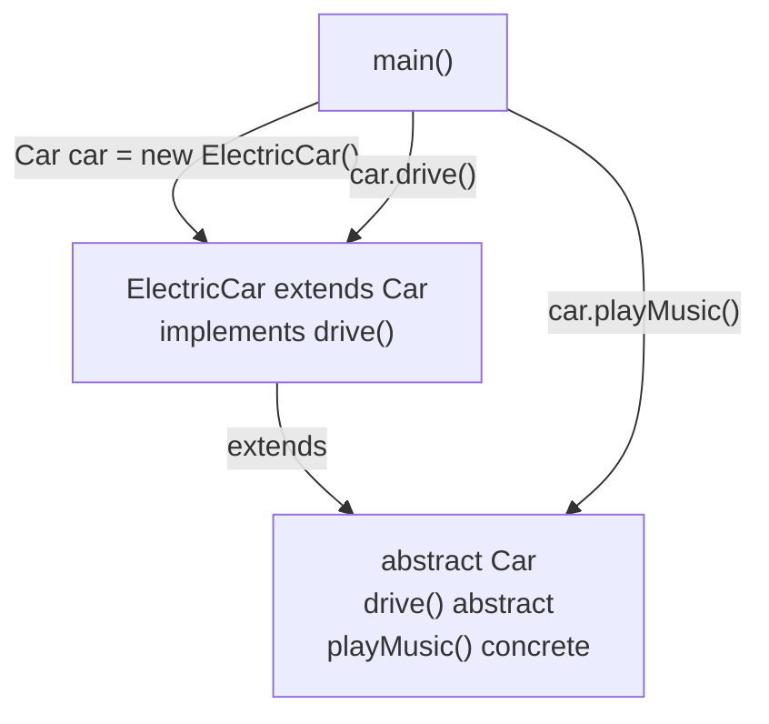

# AbstractKeyword — abstract class and implementation

`Car` is abstract, so `main` cannot instantiate it directly. `ElectricCar`
implements the abstract `drive()` method. `main` stores an `ElectricCar` in a
`Car` reference, then calls the implementation and the inherited `playMusic()`.

