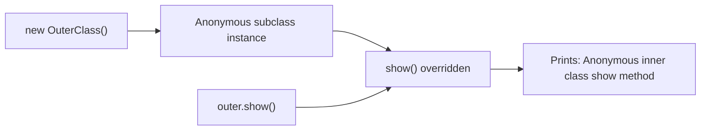

# AnonymousInnerClass — overriding with an anonymous class

`new OuterClass() { ... }` creates an anonymous subclass of `OuterClass` and
overrides `show()`. The `outer` reference points to that instance, so
`outer.show()` runs the anonymous override.

